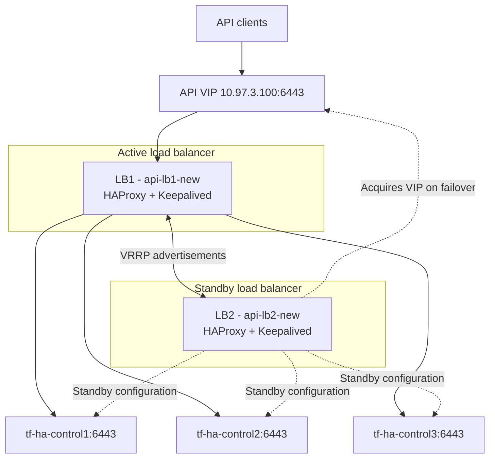

# Platform Architecture Overview

## 1. Purpose

Describe the proposed logical architecture for Kubernetes in Finance.

This document establishes the architecture baseline. Implementation details
remain subject to validation and Architecture Decision Records.

## 2. Infrastructure constraints

- One Linux Mint physical host.
- AMD Ryzen 5 3600X, 6 physical cores and 12 threads.
- 16 GB physical memory.
- Multipass 1.17 using QEMU.
- Three available Multipass network zones.
- Five Kubernetes virtual machines.
- Two existing load-balancer virtual machines.

All VMs share one physical failure domain. Multipass zones simulate
infrastructure separation; they are not independent physical availability
zones.

The load balancers have two network interfaces:

- Management connectivity through their respective Multipass zone networks.
- Frontend connectivity through the shared `br-api-frontend` bridge.

The frontend network uses subnet `10.97.3.0/24`. The API virtual IP is
`10.97.3.100`.

## 3. Kubernetes and load-balancer topology

### Kubernetes nodes

| Node | Role | Zone | Management IP |
|---|---|---|---|
| tf-ha-control1 | Control plane / etcd | zone1 | 10.97.0.16 |
| tf-ha-control2 | Control plane / etcd | zone2 | 10.97.1.160 |
| tf-ha-control3 | Control plane / etcd | zone3 | 10.97.2.213 |
| tf-ha-worker1 | Application workloads | zone1 | 10.97.0.2 |
| tf-ha-worker2 | Application workloads | zone2 | 10.97.1.111 |

### Load balancers

| VM | Zone | Management IP | Frontend IP | VRRP priority |
|---|---|---|---|---|
| api-lb1-new | zone2 | 10.97.1.141 | 10.97.3.11 | 150 |
| api-lb2-new | zone3 | 10.97.2.242 | 10.97.3.12 | 100 |

Both load balancers use Keepalived with VRRP virtual router ID 51.
LB1 has higher priority; LB2 is configured as BACKUP.

The shared API virtual IP is `10.97.3.100/24`. Keepalived dynamically
assigns this address to the active load balancer's frontend interface.

### Logical API traffic flow

## 4. Control-plane architecture

The design includes:

- Three control-plane nodes.
- Three stacked etcd members.
- Two HAProxy instances configured for Kubernetes API TCP forwarding.
- Keepalived managing API endpoint VIP ownership through VRRP.
- A stable Kubernetes `controlPlaneEndpoint` using the API VIP.

### Implementation and validation status

The following infrastructure components have been configured:

- Two existing load-balancer VMs across zone2 and zone3.
- HAProxy configuration deployed through Ansible.
- Keepalived configuration deployed through Ansible.
- `net.ipv4.ip_nonlocal_bind` enabled to allow HAProxy to bind the VIP
  when the local node does not currently own it.
- VRRP failover demonstrated by stopping Keepalived on LB1 and observing
  LB2 acquire `10.97.3.100`.

Kubernetes has not yet been bootstrapped. Consequently, successful
end-to-end API traffic forwarding, control-plane health checks and
Kubernetes API availability have not yet been demonstrated.

The load-balancer VMs share a frontend network, allowing VRRP
advertisements and VIP ownership to operate across their frontend
interfaces. This architecture does not establish independent physical
failure domains.

## 5. Workload networking

Cilium is the proposed Kubernetes CNI.

Validation will cover:

- Pod-to-pod connectivity.
- Cross-node connectivity.
- Pod-to-Service connectivity.
- DNS resolution.
- NetworkPolicy enforcement.
- Node and workload failure behaviour.

Kube-proxy replacement is not assumed and requires a separate decision.

## 6. Delivery architecture

1. Engineer proposes a change in GitHub.
2. CI validates source and configuration.
3. Required review and change authorization occur.
4. Flux reconciles approved Kubernetes desired state.
5. Monitoring verifies platform and service health.
6. Deployment evidence is linked to the change record.

GitOps reconciliation does not replace change authorization.

## 7. Observability architecture

The initial design will evaluate:

- Prometheus for metrics collection and alert evaluation.
- Alertmanager for alert grouping and routing.
- Grafana for dashboards.
- Node Exporter for host metrics.
- kube-state-metrics for Kubernetes object state.
- Blackbox Exporter for endpoint availability checks.
- Centralized logging as a separately evaluated capability.

Monitoring will cover the host, nodes, control plane, workloads and critical
service paths.

Monitoring availability and resource consumption will be measured.
The initial monitoring deployment may itself be a single failure domain.

## 8. Security boundaries

Document and validate:

- Host and VM boundaries.
- Kubernetes control-plane access.
- Worker and workload boundaries.
- Administrative access.
- API access.
- GitHub and GitOps trust boundaries.
- Identity and secrets dependencies.
- Monitoring and notification dependencies.

## 9. Known limitations

- All VMs share one physical host.
- Multipass zones are simulated failure domains.
- Local networking does not prove cloud networking behaviour.
- The initial cluster has constrained compute and memory.
- Monitoring may initially be single-instance.
- External notification delivery depends on configured integrations.

## 10. Open architecture questions

1. Can the control-plane nodes support the required API VIP across zones?
2. What routing and firewall rules are required between zone subnets?
3. What resource allocation is sustainable with observability workloads?
4. What logs should be retained, and for how long?
5. Where should backups reside to provide meaningful separation from the
   Kubernetes cluster?

## 11. AI-assisted engineering governance

AI tools may assist with architecture analysis, implementation, troubleshooting,
testing and documentation. They do not replace engineering accountability,
architectural decision authority or independent validation.

AI-generated recommendations must be checked against the documented project
objectives, current implementation, approved Architecture Decision Records
and established constraints. Conflicts with approved decisions must be
identified and raised rather than silently introducing a change in direction.

Material architectural changes, scope changes, security decisions and
destructive or production-impacting actions require human authorization.

The governing principle is:

**AI proposes. Evidence challenges. Humans authorize. Automation executes.
Validation confirms.**

See the [AI Engineering Governance](../ai-engineering/AI_ENGINEERING_GOVERNANCE.md)
document for the detailed controls and responsibilities.
