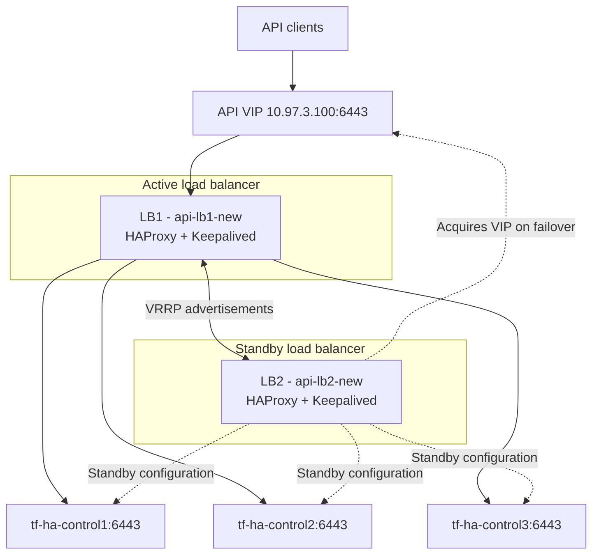

# Platform Architecture Overview

## 1. Purpose

Describe the proposed logical architecture for Kubernetes in Finance.

This document establishes the architecture baseline. Implementation details
remain subject to validation and Architecture Decision Records.

## 2. Infrastructure constraints

- One Linux Mint physical host.
- AMD Ryzen 5 3600X, 6 physical cores and 12 threads.
- 16 GB physical memory.
- Multipass 1.17 using QEMU.
- Three available Multipass network zones.
- Five Kubernetes virtual machines.
- Two existing load-balancer virtual machines.

All VMs share one physical failure domain. Multipass zones simulate
infrastructure separation; they are not independent physical availability
zones.

The load balancers have two network interfaces:

- Management connectivity through their respective Multipass zone networks.
- Frontend connectivity through the shared `br-api-frontend` bridge.

The frontend network uses subnet `10.97.3.0/24`. The API virtual IP is
`10.97.3.100`.

## 3. Kubernetes and load-balancer topology

### Kubernetes nodes

| Node | Role | Zone | Management IP |
|---|---|---|---|
| tf-ha-control1 | Control plane / etcd | zone1 | 10.97.0.16 |
| tf-ha-control2 | Control plane / etcd | zone2 | 10.97.1.160 |
| tf-ha-control3 | Control plane / etcd | zone3 | 10.97.2.213 |
| tf-ha-worker1 | Application workloads | zone1 | 10.97.0.2 |
| tf-ha-worker2 | Application workloads | zone2 | 10.97.1.111 |

### Load balancers

| VM | Zone | Management IP | Frontend IP | VRRP priority |
|---|---|---|---|---|
| api-lb1-new | zone2 | 10.97.1.141 | 10.97.3.11 | 150 |
| api-lb2-new | zone3 | 10.97.2.242 | 10.97.3.12 | 100 |

Both load balancers use Keepalived with VRRP virtual router ID 51.
LB1 has higher priority; LB2 is configured as BACKUP.

The shared API virtual IP is `10.97.3.100/24`. Keepalived dynamically
assigns this address to the active load balancer's frontend interface.

### Logical API traffic flow

## 4. Control-plane architecture

The design includes:

- Three control-plane nodes.
- Three stacked etcd members.
- Two HAProxy instances configured for Kubernetes API TCP forwarding.
- Keepalived managing API endpoint VIP ownership through VRRP.
- A stable Kubernetes `controlPlaneEndpoint` using the API VIP.

### Implementation and validation status

The infrastructure and Kubernetes control plane have been deployed:

- Two load-balancer VMs across zone2 and zone3.
- HAProxy and Keepalived configured through Ansible.
- VRRP failover demonstrated by stopping Keepalived on LB1 and
  observing LB2 acquire `10.97.3.100`.
- Three Kubernetes control-plane nodes bootstrapped.
- Three stacked etcd members reporting healthy endpoints.
- Two worker nodes joined to the cluster.
- Kubernetes API access through the configured API VIP.
- All five Kubernetes nodes reporting Ready.

The Kubernetes networking layer is deployed:

- Cilium 1.20.4 installed on all five nodes.
- kube-proxy replacement enabled.
- Kubernetes pod CIDR: `10.244.0.0/16`.
- Kubernetes Service CIDR: `10.112.0.0/12`.
- Cilium Kubernetes IPAM with VXLAN overlay routing.
- Cross-node pod HTTP connectivity demonstrated in both directions.

Cross-zone networking tests identified and mitigated a
Multipass host NAT issue that translated internal source addresses.
An Ansible-managed systemd service and timer now reconcile the
host POSTROUTING exemption. Captured VXLAN traffic shows original
node source addresses preserved after the change.

Service execution, rule ordering, idempotency and host reboot
persistence are validated. After reboot, all five Kubernetes
nodes recovered to Ready, API readiness checks passed through
the configured API VIP, and all three etcd endpoints successfully
committed proposals.

Kubernetes Service routing, DNS, NetworkPolicy enforcement,
Hubble flow validation and component failure/recovery testing
remain outstanding.

All VMs share one physical host. Multipass zones simulate
infrastructure separation but do not provide independent physical
failure domains.

## 5. Workload networking

Cilium 1.20.4 is the deployed Kubernetes CNI. It provides eBPF-based
networking, kube-proxy replacement and VXLAN overlay routing.

The current configuration uses:

- Kubernetes IPAM.
- Pod CIDR `10.244.0.0/16`.
- Service CIDR `10.112.0.0/12`.
- VXLAN encapsulation over UDP port `8472`.
- kube-proxy replacement.

### Validated

- Cilium agents operate on all five Kubernetes nodes.
- Cross-node pod HTTP connectivity works in both directions.
- VXLAN encapsulation traffic has been observed.
- Original node source addresses have been observed in VXLAN
  outer packet headers.

### Pending validation

- Kubernetes Service routing.
- DNS resolution across workloads.
- NetworkPolicy enforcement.
- Hubble network-flow visibility.
- Cilium agent, node and control-plane failure and recovery.
- Kubernetes Service routing, DNS, NetworkPolicy enforcement and Hubble flow validation.

See `docs/decisions/ADR-004-networking.md` for the networking
decision and `docs/runbooks/network-connectivity.md` for
validation procedures.

## 6. Delivery architecture

The delivery architecture separates workflow orchestration, infrastructure
provisioning, host configuration, platform component installation and
Kubernetes runtime reconciliation.

### Responsibilities

| Component | Responsibility |
|---|---|
| GitHub | Source control, pull requests and change history. |
| GitHub Actions | CI validation and future deployment workflow orchestration. |
| Terraform | Infrastructure provisioning and lifecycle management. |
| Ansible | Host configuration and operational orchestration. |
| Helm | Packaging and installation of Kubernetes platform components. |
| Flux | Continuous reconciliation of approved Kubernetes desired state. |
| Monitoring | Deployment health, operational visibility and alerting. |

### Intended delivery workflow

1. Engineer proposes a change through a GitHub pull request.
2. CI validates source code, infrastructure configuration and automation.
3. Required review and change authorization occur.
4. Approved workflows invoke Terraform, Ansible or Helm as appropriate.
5. Flux reconciles approved Kubernetes desired state where applicable.
6. Automated validation verifies platform and workload health.
7. Deployment identity, approval and validation evidence are retained.

### Implementation status

GitHub Actions deployment orchestration is a planned capability.
The initial implementation will use a secured self-hosted runner
to reach the private Multipass network.

Terraform, Ansible and Helm remain independently usable automation
tools. GitHub Actions will coordinate their execution rather than
replace their responsibilities.

Flux remains responsible for Kubernetes desired-state reconciliation.
It does not replace CI validation, deployment authorization or
infrastructure lifecycle management.

### Security and governance

- Protect workflow execution through repository permissions and branch protection.
- Require approval for infrastructure changes and sensitive deployment operations.
- Use dedicated, restricted deployment identities.
- Prevent credentials from entering logs, artifacts or source control.
- Retain traceability between source changes, approvals, deployments and validation.

The detailed GitHub Actions implementation is deferred until the
initial highly available Kubernetes platform is operational.

## 7. Observability architecture

The initial design will evaluate:

- Prometheus for metrics collection and alert evaluation.
- Alertmanager for alert grouping and routing.
- Grafana for dashboards.
- Node Exporter for host metrics.
- kube-state-metrics for Kubernetes object state.
- Blackbox Exporter for endpoint availability checks.
- Centralized logging as a separately evaluated capability.

Monitoring will cover the host, nodes, control plane, workloads and critical
service paths.

Monitoring availability and resource consumption will be measured.
The initial monitoring deployment may itself be a single failure domain.

## 8. Security boundaries

Document and validate:

- Host and VM boundaries.
- Kubernetes control-plane access.
- Worker and workload boundaries.
- Administrative access.
- API access.
- GitHub and GitOps trust boundaries.
- Identity and secrets dependencies.
- Monitoring and notification dependencies.

## 9. Known limitations

- All VMs share one physical host.
- Multipass zones are simulated failure domains.
- Local networking does not prove cloud networking behaviour.
- The initial cluster has constrained compute and memory.
- Monitoring may initially be single-instance.
- External notification delivery depends on configured integrations.

## 10. Open architecture questions

1. Can the control-plane nodes support the required API VIP across zones?
2. What routing and firewall rules are required between zone subnets?
3. What resource allocation is sustainable with observability workloads?
4. What logs should be retained, and for how long?
5. Where should backups reside to provide meaningful separation from the
   Kubernetes cluster?

## 11. AI-assisted engineering governance

AI tools may assist with architecture analysis, implementation, troubleshooting,
testing and documentation. They do not replace engineering accountability,
architectural decision authority or independent validation.

AI-generated recommendations must be checked against the documented project
objectives, current implementation, approved Architecture Decision Records
and established constraints. Conflicts with approved decisions must be
identified and raised rather than silently introducing a change in direction.

Material architectural changes, scope changes, security decisions and
destructive or production-impacting actions require human authorization.

The governing principle is:

**AI proposes. Evidence challenges. Humans authorize. Automation executes.
Validation confirms.**

See the [AI Engineering Governance](../ai-engineering/AI_ENGINEERING_GOVERNANCE.md)
document for the detailed controls and responsibilities.
